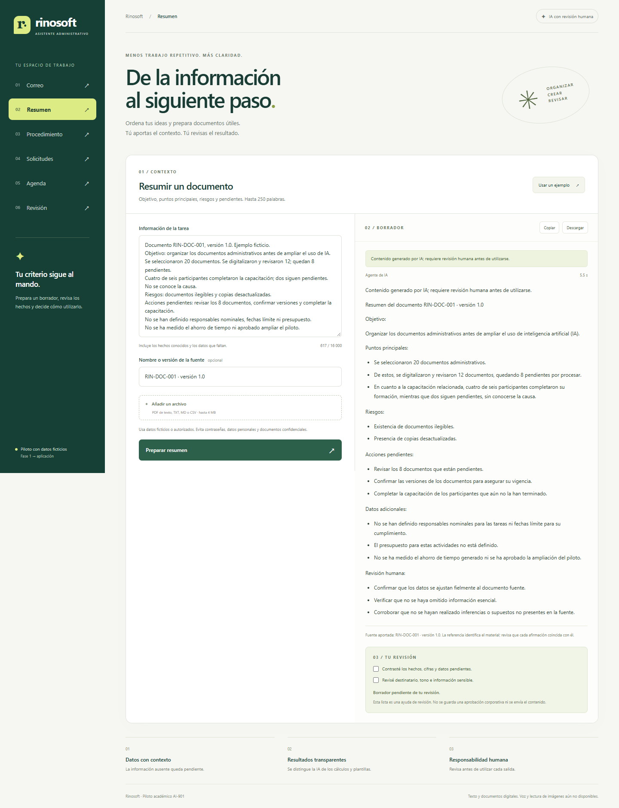

# Rinosoft — Asistente administrativo responsable

Proyecto integrador **AI-901**, opción B: implementación en Azure del proyecto de la fase 1. Autor: **Jorge Augusto Perales Soberanes**.

**[Abrir la aplicación en Azure](https://rinosoft-augusto-ai901.azurewebsites.net/)** · [Documentación del proyecto](docs/Documentacion_AI901_Rinosoft.md) · [Resultados de pruebas](docs/Pruebas_app_Azure_Rinosoft.md)

Rinosoft ayuda a preparar borradores administrativos y revisar información con supervisión humana. La aplicación está publicada en **Azure Functions Flex Consumption** y utiliza un agente de **Microsoft Foundry** para tres tareas. Este repositorio contiene su código, documentación y capturas reales.



## Probar la aplicación

1. Abrir el enlace de Azure; no requiere entrar al portal ni instalar programas.
2. Seleccionar **Resumen**, **Procedimiento** o **Revisión** para probar una respuesta nueva del agente.
3. Pulsar **Usar un ejemplo** y después el botón de la tarea.
4. Contrastar la salida con la fuente y revisar datos pendientes antes de copiar o descargar el borrador.

Utilizar los ejemplos ficticios incluidos. El piloto público no tiene autorización empresarial por usuario y no debe recibir información confidencial real. Su disponibilidad depende de los recursos y del crédito de Azure del proyecto.

## Funciones y métodos

| Tarea | Implementación |
| --- | --- |
| Correo de recepción | Plantilla controlada, sin inventar registro, revisión o compromisos. |
| Resumen | Agente de Foundry; hasta 250 palabras, con fuente y pendientes. |
| Procedimiento | Borrador del agente con responsables, tiempos y aprobación por definir. |
| Solicitudes | Cálculos con Decimal sobre CSV; informa filas inválidas y exclusiones. |
| Agenda | Distribución comprobable de 30 minutos entre 2–8 temas. |
| Revisión sensible | Orientación del agente sobre categorías y minimización; regla previa de credenciales. |

## Arquitectura

Navegador → Flask en Azure Functions → reglas controladas o agente de Microsoft Foundry.

- Entra ID e identidad administrada autentican al servidor ante Foundry y Azure Storage.
- Blob Storage privado guarda el despliegue y un contador diario compartido; no actúa como archivo de documentos del usuario.
- Las credenciales y la configuración del entorno no forman parte del repositorio.
- Las consultas de IA se aíslan en conversaciones independientes; la app intenta limpiar sus artefactos temporales.

## Documentación y estructura

```text
app.py                      Servidor Flask, validación y tareas
function_app.py             Adaptador de Azure Functions
host.json                   Configuración de Functions
requirements.txt            Dependencias de Python
templates/                  Interfaz web
static/                     Estilos, interacción y capturas
docs/                       Documento de entrega, pruebas e implementación
tests/test_app.py           Pruebas locales sin llamadas al modelo
```

- [Documento de entrega con capturas](docs/Documentacion_AI901_Rinosoft.md).
- [Entradas, salidas y observaciones de las pruebas públicas](docs/Pruebas_app_Azure_Rinosoft.md).
- [Instrucciones propuestas para el agente](docs/Instrucciones_agente_Rinosoft.md).
- [Configuración y despliegue en Azure](docs/Implementacion_Azure.md).

Las capturas de `docs/` usan rutas del repositorio para conservarse aunque deje de estar disponible el alojamiento de Azure. La app mantiene además su documentación descargable con imágenes HTTPS.

## Desarrollo local

Requisitos: **Python 3.12**, Azure CLI y una cuenta autorizada para consumir el proyecto de Foundry. La aplicación lee variables de entorno; no carga archivos `.env` automáticamente.

En PowerShell, desde la raíz del repositorio:

```powershell
py -3.12 -m venv .venv
.\.venv\Scripts\python.exe -m pip install -r requirements.txt

$env:PROJECT_ENDPOINT = "https://TU-RECURSO.services.ai.azure.com/api/projects/TU-PROYECTO"
$env:AGENT_NAME = "rinosoft-asistente"
$env:SECRET_KEY = (.\.venv\Scripts\python.exe -c "import secrets; print(secrets.token_hex(32))")

az login
.\.venv\Scripts\python.exe app.py
```

Abrir `http://127.0.0.1:5050`. El código de esta versión está vinculado al directorio institucional del proyecto para el acceso local; para portarlo a otro directorio se debe ajustar la selección de tenant de `AzureCliCredential` en `FoundryGateway`. En Azure se utiliza la identidad administrada indicada por `AZURE_CLIENT_ID`.

El modo local sirve para desarrollo; la entrega del prototipo se utiliza mediante el enlace de Azure. La sesión de Azure y el secreto generado deben mantenerse fuera de Git.

## Pruebas

```powershell
.\.venv\Scripts\python.exe -m unittest discover -s tests -v
```

Las **15 pruebas locales** verifican plantillas, cálculos, duración de agenda, aislamiento, CSRF, credenciales, archivos, longitud y errores. Utilizan un agente simulado; no requieren credenciales de Azure ni consumen tokens. Las pruebas reales del agente y de la interfaz publicada están documentadas por separado con sus fechas y limitaciones.

## Alcance y pendientes

- Entrada de texto y archivos PDF digitales, TXT, MD y CSV. No hay voz, OCR ni lectura de imágenes en esta versión.
- No hay integración con correo u Office, envío automático, pagos ni aprobación corporativa durable.
- Los resultados del modelo requieren revisión; la prueba de áreas mostró diferencias residuales de interpretación.
- Sin autenticación por usuario final, Key Vault ni anonimización completa. Los controles existentes no sustituyen una revisión de seguridad empresarial.
- Límites de entrada y consultas documentados; no equivalen a un tope de gasto. El costo real debe comprobarse en Azure.

El enlace de GitHub comparte el proyecto y su evidencia. La ejecución del asistente ocurre en Azure; GitHub no sustituye el alojamiento de la aplicación.
